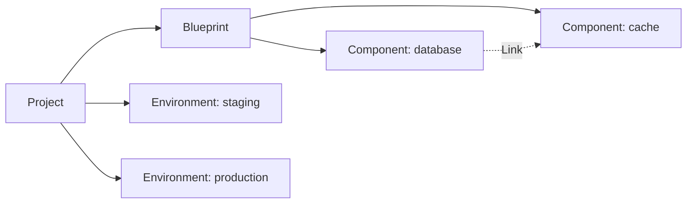
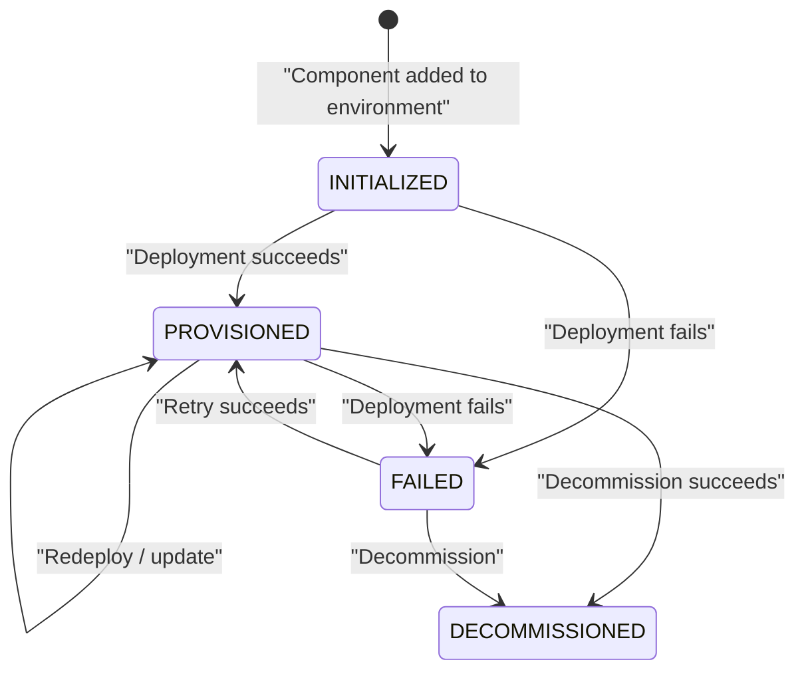

export const Bullet = () => <><span style={{ fontWeight: 'normal', fontSize: '.5em', color: 'var(--ifm-color-secondary-darkest)' }}>&nbsp;●&nbsp;</span></>

export const SpecifiedBy = (props) => <>Specification<a className="link" style={{ fontSize:'1.5em', paddingLeft:'4px' }} target="_blank" href={props.url} title={'Specified by ' + props.url}>⎘</a></>

export const Badge = (props) => <><span className={props.class}>{props.text}</span></>

import { useState } from 'react';

export const Details = ({ dataOpen, dataClose, children, startOpen = false }) => {
  const [open, setOpen] = useState(startOpen);
  return (
    <details {...(open ? { open: true } : {})} className="details" style={{ border:'none', boxShadow:'none', background:'var(--ifm-background-color)' }}>
      <summary
        onClick={(e) => {
          e.preventDefault();
          setOpen((open) => !open);
        }}
        style={{ listStyle:'none' }}
      >
      {open ? dataOpen : dataClose}
      </summary>
      {open && children}
    </details>
  );
};


Alpha: this API can change or be removed at any time, without notice.

The project, environment, component, instance, deployment, or link an annotation is on.


```graphql
union AlphaAnnotationEntity = Project | Environment | Component | Instance | Deployment | Link
```


### Possible types

#### [<code style={{ fontWeight: 'normal' }}>AlphaAnnotationEntity.<b>Project</b></code>](/api/graphql/types/objects/project.mdx) <Badge class="badge badge--secondary " text="object"/> 
A project organizes related infrastructure under a single blueprint.

Each project contains a **Blueprint** that defines your infrastructure architecture -- which
bundles to use and how they connect -- and one or more **Environments** (like staging or
production) where that architecture is actually deployed.



Attributes set on a project are inherited by all environments and instances within it.


#### [<code style={{ fontWeight: 'normal' }}>AlphaAnnotationEntity.<b>Environment</b></code>](/api/graphql/types/objects/environment.mdx) <Badge class="badge badge--secondary " text="object"/> 
A deployment target within a project where blueprint components become live infrastructure.

Each project can have multiple environments (e.g., `staging`, `production`). When you deploy
to an environment, every component in the project's blueprint is realized as an **Instance** --
a running piece of cloud infrastructure with its own configuration, state, and cost data.

Environments inherit attributes from their parent project. You can also set environment-scoped attributes
that cascade down to all instances within the environment. **Defaults** let you pre-assign
resources (like a shared VPC or DNS zone) so that new instances automatically receive them.

Before deleting an environment, all instances must be decommissioned. Use the `deletable`
field to check for blocking constraints.


#### [<code style={{ fontWeight: 'normal' }}>AlphaAnnotationEntity.<b>Component</b></code>](/api/graphql/types/objects/component.mdx) <Badge class="badge badge--secondary " text="object"/> 
A bundle placed in a project's blueprint, representing a slot for deployable infrastructure.

A component is the **design-time** building block of your architecture. It says
"I want a database here" or "I need a Kubernetes cluster there." The component
defines *what* to deploy; the actual running infrastructure lives in **instances**
-- one per environment the component is deployed to.

Components are connected to each other via **links**, which declare that one
component's output (e.g., a connection string) should be wired into another
component's input.


#### [<code style={{ fontWeight: 'normal' }}>AlphaAnnotationEntity.<b>Instance</b></code>](/api/graphql/types/objects/instance.mdx) <Badge class="badge badge--secondary " text="object"/> 
A deployed piece of infrastructure in an environment.

An instance is the **runtime representation** of a component. When you add a
"database" component to your blueprint and deploy it to the `staging`
environment, Massdriver creates an instance that tracks the database's
configuration, deployment state, costs, and produced resources.

**Lifecycle:** Instances progress through a well-defined set of states:



**Version resolution:** Each instance has a `version` constraint (e.g., `~1.0`)
and a `releaseStrategy` (stable or development). Together these determine
the `resolvedVersion` that will be used on the next deployment. Compare
`resolvedVersion` with `deployedVersion` to see if a redeployment is needed,
or check `availableUpgrade` for newer matching releases.


#### [<code style={{ fontWeight: 'normal' }}>AlphaAnnotationEntity.<b>Deployment</b></code>](/api/graphql/types/objects/deployment.mdx) <Badge class="badge badge--secondary " text="object"/> 
A record of an infrastructure provisioning operation.

Each deployment tracks a single action (`PROVISION`, `DECOMMISSION`, or `PLAN`) against
an instance. Deployments are immutable once created — you cannot modify a deployment,
only create new ones.

Use the `status` field to monitor progress and `elapsed_time` to track duration.
The `deployed_by` field identifies the user or service account that initiated the operation.


#### [<code style={{ fontWeight: 'normal' }}>AlphaAnnotationEntity.<b>Link</b></code>](/api/graphql/types/objects/link.mdx) <Badge class="badge badge--secondary " text="object"/> 
A design-time dependency between two components in a blueprint.

A link declares that one component's output should be wired into another
component's input. For example, a link from a database component's
`authentication` output to an application component's `database` input
ensures the app receives the database connection string.

At deploy time, each link is realized as a **connection** in the environment,
wiring the actual instance outputs to instance inputs.


### Member Of

[`AlphaAnnotation`](/api/graphql/types/objects/alpha-annotation.mdx)  <Badge class="badge badge--secondary badge--relation" text="object"/>