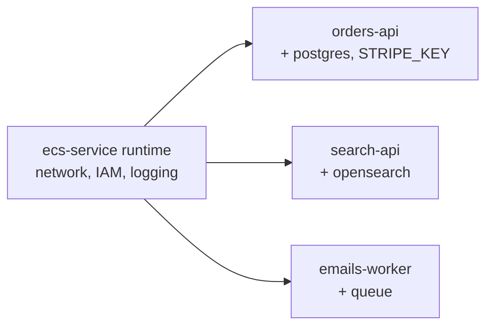

Ship a service by writing about twenty lines of YAML. Your platform team has already decided how services run: the networking, the IAM, the logging, the autoscaling. That decision lives in a **runtime**. Your **application** says only what is yours: what it connects to, what it reads, and what it exposes.

```yaml title="massdriver.yaml"
name: orders-api
description: Takes and tracks orders.
version: 0.3.0

dependencies:
  db:
    resource_type: postgres@~1
    required: true

app:
  runtime: ecs-service@~2
  envs:
    DB_HOST: .dependencies.db.authentication.hostname
  secrets:
    STRIPE_KEY:
      required: true
```

That is the whole application. No Terraform, no Helm chart, no copy of someone else's module.

## Who owns what

| | Runtime | Application |
|---|---|---|
| **Written by** | The platform team | The team that owns the service |
| **Holds** | The IaC, params, and configuration form | Dependencies, resources, envs, and secrets |
| **Decides** | How the service runs: compute, network, IAM, logs | What the service needs and what it offers |
| **Versioned** | On its own | On its own, pinned to the runtime version it was built on |

Everything an application gets from its runtime is **inherited**. The application can add to it, but it cannot change it. When the platform team ships a fix, applications pick it up the next time they publish.



## What a runtime can do for you

- Create an IAM role or service account for each application, scoped to what it connects to.
- Run the application as a container on the compute your organization chose.
- Turn the application's dependencies and params into environment variables.
- Grant the application access to the databases, buckets, and queues it depends on.

Common runtimes:

- AWS Lambda and ECS services
- Azure App Service
- GCP Cloud Run
- Kubernetes deployments, cron jobs, and jobs on EKS, AKS, GKE, or your own clusters

A runtime is a bundle in your organization. You need `repo:pull` access to its repository to build on it. The [application-templates](https://github.com/massdriver-cloud/application-templates) repository is a starting point for writing one.

## Next steps

- [Create an application](/applications/create): write the `massdriver.yaml` and publish it.
- [Deploy an application](/applications/deploy): add it to a project and ship it.
- [Runtimes and Applications](/bundle-development/runtimes-and-applications): the full reference, including how to publish a runtime and see which versions your fleet runs.
