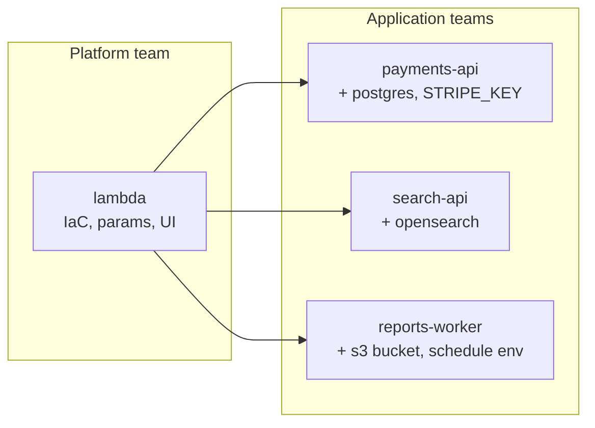
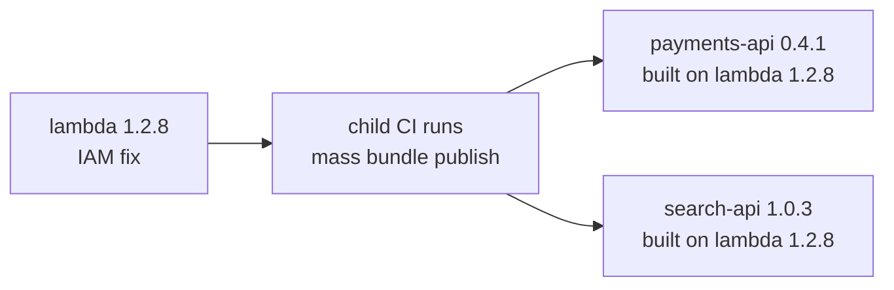

# Extending Bundles

A bundle can extend another bundle. The child reuses the parent's infrastructure code, params, and UI, and adds what is specific to one application: its name and version, extra dependencies, environment variables, secrets, and the resources it emits.

This lets a platform team own one well-tested bundle, such as a Lambda function or a Kubernetes service, while each application team keeps a single `massdriver.yaml` with no IaC of its own.

## Why extend instead of copy

Most applications in an organization run on a handful of shapes: a function, a container service, a worker. Without inheritance, each application team either deploys the generic bundle and wires up everything by hand in every environment, or copies the bundle's IaC into its own repository. Copies drift. A security fix, a tagging change, or a new compliance control has to be applied to every copy, and some never get it.

With `extends`, the IaC exists once. Application bundles carry only what differs between applications, and that difference is small enough to review at a glance.



Each child is still a complete, versioned bundle. It appears in the catalog under its own name, deploys like any other bundle, and records exactly which parent release it was built from.

## Use cases

**A golden path for application teams.** The platform team publishes `ecs-service` with sane defaults for networking, logging, autoscaling, and IAM. A team shipping `orders-api` extends it, adds its database dependency and two env vars, and never opens a `.tf` file. Developers see a bundle named for their application, with a form that has only the params the platform team chose to expose.

**Rolling out a fix across many applications.** A vulnerability requires a change to how the function's IAM role is scoped. The platform team releases `lambda@1.2.8`. Every child that extends `lambda@~1.2` picks up the fix the next time it is published, from a CI pipeline or a quick `mass bundle publish`, with no edits to the child.



**Applications that publish their own contract.** `billing-api` extends the generic `lambda` bundle, but other services should depend on a `billing-api` resource type, not on "some Lambda function." The child declares that resource and fills it from the parent's outputs, so downstream bundles connect to billing by type and receive only the fields that type defines.
## Example

```yaml
extends: lambda@~1.2
name: payments-api
description: Handles card captures.
version: 0.1.0

dependencies:
  db:
    resource_type: postgres@~1
    required: true

app:
  envs:
    DB_HOST: .dependencies.db.host
  secrets:
    STRIPE_KEY:
      required: true
```

## How it works

Inheritance happens when you build. `mass bundle build` and `mass bundle publish`:

1. Resolve the `extends` constraint to the newest matching parent version.
2. Pull that parent from your organization's registry.
3. Merge the child's `massdriver.yaml` onto the parent's.
4. Copy the child's `README.md`, `CHANGELOG.md`, `icon.svg`, and `operator.md` over the parent's.

`publish` then pushes the result as an ordinary bundle. Instances, deployments, and the UI treat it like any other bundle; the parent is not consulted again after publish.

## Choosing a parent version

`extends` takes `<bundle>@<constraint>`, using the same constraint forms as [dependency versions](/bundle-development/dependencies-resources/version-resolution):

| Form | Builds against |
|------|----------------|
| `lambda@1.2.7` | that exact version |
| `lambda@~1.2` | the newest `1.2.x` |
| `lambda@~1` | the newest `1.x` |
| `lambda@latest` or `lambda` | the newest stable version |
| `lambda@~1.2+dev` | the newest `1.2.x`, including development releases |

The constraint resolves each time you build, so a new parent release reaches the child the next time the child is published. Existing child releases keep the parent code they were built with.

The published `massdriver.yaml` records exactly which parent was used:

```yaml
extends:
  name: lambda
  constraint: ~1.2
  version: 1.2.7
  digest: sha256:...
```

The parent must be in your organization, and you need `repo:pull` access to its repository.

## What the child can set

The parent owns everything that shapes the infrastructure: `steps`, `params`, `ui`, its `resources`, and its IaC. The child supplies:

| Key | Behavior |
|-----|----------|
| `name` | Required. The child's own bundle name. |
| `version` | Required. The child's own version, independent of the parent's. |
| `description`, `source_url` | Replace the parent's. The parent's `source_url` is never inherited. |
| `dependencies` | Added to the parent's dependencies. |
| `app.envs`, `app.secrets` | Added to the parent's. Any other `app` key fails the build. |
| `resources` | Added to the parent's resources. Each must be emitted by a step (see below). |
| `steps` | Attaches resource templates to the parent's steps. Cannot add, remove, or reconfigure steps. |

Any other key, such as `params` or `ui`, fails the build. To change those, change the parent or fork it.

## Adding dependencies

Child dependencies are added alongside the parent's and become inputs to the parent's IaC like any other dependency. Use them from `app.envs`:

```yaml
dependencies:
  cache:
    resource_type: redis@~1
    required: true

app:
  envs:
    CACHE_URL: .dependencies.cache.url
```

A dependency name must not match a dependency or param the parent already declares.

## Environment variables and secrets

`app.envs` and `app.secrets` are added to the parent's. Each name must be new; redefining a parent env or secret fails the build.

Every `app.envs` expression must reference params and dependencies that exist in the merged bundle. An expression that reads an optional dependency builds with a warning, because deployments fail while that dependency is not connected.

The parent's IaC decides what happens to envs and secrets. If the parent has no `app` block, its IaC most likely ignores them, and the build warns that the child's `app` block may have no effect.

## Emitting resources

A child can publish resources of its own, for example a `billing-api` resource that other bundles depend on. Declare the resource, then attach a jq template to the parent step that should emit it:

```yaml
resources:
  billing:
    resource_type: billing-api@1.0.0
    required: true

steps:
  - path: src
    resources:
      billing:
        template: |
          {
            url: .outputs.function_url,
            region: .params.region
          }
```

The template renders after that step applies. It can read the step's IaC outputs as `.outputs` and the instance's params as `.params`.

- `path` must name one of the parent's steps. A child step can set only `path` and `resources`.
- Each entry under a step's `resources` is a map with a `template` key holding the jq.
- Every child resource needs exactly one template, and every template must belong to a declared resource.
- A child resource must not reuse a parent resource name.

Output names belong to the parent's IaC. If a parent release renames an output, the template breaks at deploy time, so pin the parent to a range that keeps its outputs stable.

## Building and publishing

Build locally to inspect the merged bundle:

```bash
mass bundle build
```

The merged bundle is assembled in `.massdriver/build/` next to the child's `massdriver.yaml`. The `.massdriver/` directory contains its own `.gitignore`, so nothing is committed. Each build starts from a clean directory.

Publish as usual:

```bash
mass bundle publish --development
mass bundle publish
```

`publish` assembles in a temporary directory, so it always uses the newest matching parent regardless of what is in `.massdriver/build/`.

## Requirements

- The parent must use `dependencies` and `resources`. A parent that still uses the legacy `connections` or `artifacts` fields cannot be extended until it is republished in the current format.
- The child must use the current format as well.
- The child's own IaC is not used. Directories such as `src/` in the child repository are ignored.

## Related documentation

- [Bundle YAML Specification](/bundle-development/bundle-yaml-spec)
- [Version Resolution](/bundle-development/dependencies-resources/version-resolution)
- [Bundle Versioning](/bundle-development/publishing/versioning)
