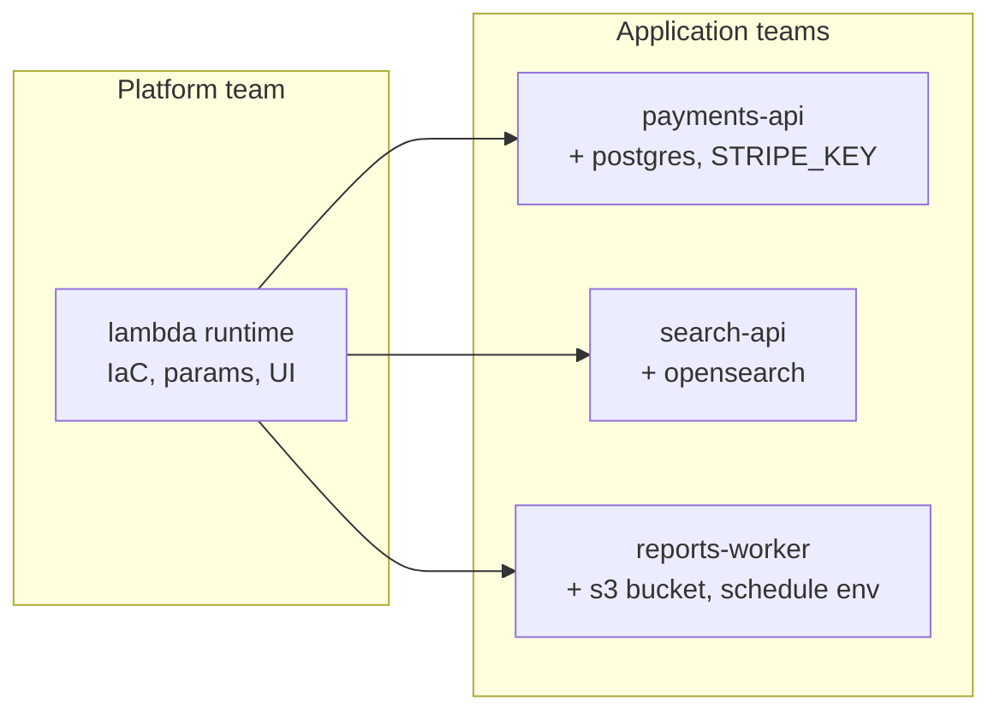
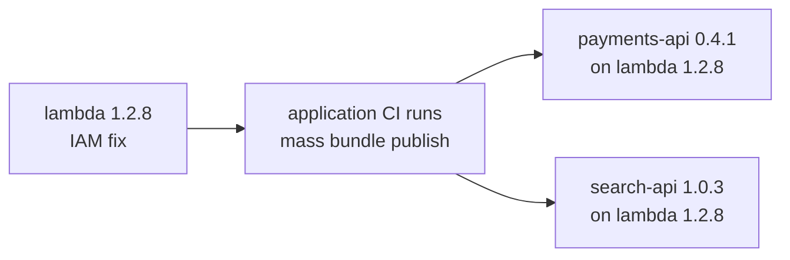

# Runtimes and Applications

A **runtime** is a bundle that defines how applications run on a cloud: a Lambda function, a Kubernetes deployment, an ECS service, a worker. Its IaC decides scheduling, networking, IAM, and logging, and developers cannot change it.

An **application** is a bundle that runs on a runtime. It adds only what is specific to that application: its name and version, the dependencies it needs, the environment variables and secrets it reads, and the resources it emits for other services to depend on. An application is a single `massdriver.yaml` with no IaC of its own.

## Why runtimes

Most applications in an organization run on a handful of shapes. Without runtimes, each application either deploys a generic bundle and is wired up by hand in every environment, or carries a copy of the IaC in its own repository. Copies drift. Every developer can change what their infrastructure looks like, a security fix has to be applied to every copy, and the platform team ends up reviewing many modules that are mostly the same.

With runtimes, the IaC exists once. Applications carry only what differs between them, and that difference is small enough to review at a glance.



The split follows who consumes a dependency and when. The runtime owns provision-time dependencies, the ones its IaC uses while it runs: the IAM role, the VPC, the cluster, the cloud credential. The application owns run-time dependencies, the ones its process talks to after deploy: Postgres, Redis, a queue, another service's endpoint.

Each application is still a complete, versioned bundle. It appears in the catalog under its own name, deploys like any other bundle, and records exactly which runtime release it was built from.

## Use cases

**A golden path for application teams.** The platform team publishes an `ecs-service` runtime with networking, logging, autoscaling, and IAM already decided. `orders-api` runs on it, adds a database and two environment variables, and ships. Developers see a form with only the params the platform team chose to expose.

**Rolling out a fix across many applications.** `lambda@1.2.8` scopes the IAM role more tightly. Every application on `lambda@~1.2` is rebuilt on 1.2.8 the next time it is published, from CI or a quick `mass bundle publish`. Nobody edits an application.



**Applications that publish their own contract.** `billing-api` runs on `lambda` but emits a `billing-api` resource, so other services depend on billing by type and never see the function underneath.

## Declaring what a bundle provides

`provides` lists what a bundle offers, from a fixed set. The catalog uses it for filters and badges, and each value is checked when the bundle is published.

| Value | Meaning |
|-------|---------|
| `compute` | Runs workloads: functions, containers, VMs, clusters. |
| `networking` | Networks, subnets, load balancers, DNS. |
| `storage` | Buckets, volumes, file systems. |
| `data` | Databases, caches, warehouses. |
| `messaging` | Queues, topics, streams. |
| `authentication` | Credentials, identities, and access for other bundles. |
| `runtime` | Applications can run on this bundle. |
| `application` | An application that other bundles can depend on. |

```yaml
provides: [compute, runtime]
```

- A bundle that lists any value must declare at least one entry in `resources`.
- Each value may appear once, and values outside the set fail the publish.
- `provides` is optional for now. Publishing without it prints a warning; it becomes required in the next major release.

## Publishing a runtime

Add `runtime` to `provides` and give the runtime an `app` block. The runtime's IaC must consume the envs and secrets in that block, because that is how applications reach their process.

```yaml
name: lambda
version: 1.2.7
provides: [compute, runtime]

resources:
  function:
    resource_type: aws-lambda@1.0.0
    required: true

app:
  envs:
    LOG_LEVEL: .params.log_level
```

A runtime without an `app` block fails to publish, and so does a bundle that both provides `runtime` and sets `app.runtime`.

## Writing an application

Set `app.runtime` to the runtime the application runs on:

```yaml
name: payments-api
description: Handles card captures.
version: 0.1.0

dependencies:
  db:
    resource_type: postgres@~1
    required: true

app:
  runtime: lambda@~1.2
  envs:
    DB_HOST: .dependencies.db.host
  secrets:
    STRIPE_KEY:
      required: true
```

## How it works

`mass bundle build` and `mass bundle publish`:

1. Resolve the `app.runtime` constraint to the newest matching runtime version.
2. Pull that runtime from your organization's registry and check that its `provides` includes `runtime`.
3. Merge the application's `massdriver.yaml` onto the runtime's.
4. Copy the application's `README.md`, `CHANGELOG.md`, `icon.svg`, and `operator.md` over the runtime's.

`publish` then pushes the result as an ordinary bundle. Instances, deployments, and the UI treat it like any other bundle; the runtime is not consulted again after publish.

## Choosing a runtime version

`app.runtime` takes `<runtime>@<constraint>`, using the same constraint forms as [dependency versions](/bundle-development/dependencies-resources/version-resolution):

| Form | Builds against |
|------|----------------|
| `lambda@1.2.7` | that exact version |
| `lambda@~1.2` | the newest `1.2.x` |
| `lambda@~1` | the newest `1.x` |
| `lambda@latest` or `lambda` | the newest stable version |
| `lambda@~1.2+dev` | the newest `1.2.x`, including development releases |

The constraint resolves each time you build, so a new runtime release reaches the application the next time the application is published. Existing application releases keep the runtime code they were built with.

The published `massdriver.yaml` records exactly which runtime was used:

```yaml
app:
  runtime:
    name: lambda
    constraint: ~1.2
    version: 1.2.7
    digest: sha256:...
```

The runtime must be in your organization, and you need `repo:pull` access to its repository.

## What an application can set

The runtime owns everything that shapes the infrastructure: `steps`, `params`, `ui`, its `resources`, and its IaC. The application supplies:

| Key | Behavior |
|-----|----------|
| `name` | Required. The application's own bundle name. |
| `version` | Required. The application's own version, independent of the runtime's. |
| `description`, `source_url` | Replace the runtime's. The runtime's `source_url` is never inherited. |
| `provides` | The application's own. The runtime's `provides` is never inherited, and an application cannot provide `runtime`. |
| `dependencies` | Added to the runtime's dependencies. |
| `app.runtime` | Required. The runtime the application runs on. |
| `app.envs`, `app.secrets` | Added to the runtime's. Any other `app` key fails the build. |
| `resources` | Added to the runtime's resources. Each must be emitted by a step (see below). |
| `steps` | Attaches resource templates to the runtime's steps. Cannot add, remove, or reconfigure steps. |

Any other key, such as `params` or `ui`, fails the build. An application cannot be a runtime, so applications cannot run on other applications.

## Adding dependencies

Application dependencies are added alongside the runtime's and become inputs to the runtime's IaC like any other dependency. Use them from `app.envs`:

```yaml
dependencies:
  cache:
    resource_type: redis@~1
    required: true

app:
  envs:
    CACHE_URL: .dependencies.cache.url
```

A dependency name must not match a dependency or param the runtime already declares.

## Environment variables and secrets

`app.envs` and `app.secrets` are added to the runtime's. Each name must be new; redefining a runtime env or secret fails the build.

Every `app.envs` expression must reference params and dependencies that exist in the merged bundle. An expression that reads an optional dependency builds with a warning, because deployments fail while that dependency is not connected.

## Emitting resources

An application can publish resources of its own, for example a `billing-api` resource that other bundles depend on. Declare the resource, then attach a jq template to the runtime step that should emit it:

```yaml
resources:
  billing:
    resource_type: billing-api@1.0.0
    required: true

steps:
  - path: src
    resources:
      billing:
        template: |
          {
            url: .outputs.function_url,
            region: .params.region
          }
```

The template renders after that step applies. It can read the step's IaC outputs as `.outputs` and the instance's params as `.params`.

- `path` must name one of the runtime's steps. An application step can set only `path` and `resources`.
- Each entry under a step's `resources` is a map with a `template` key holding the jq.
- Every application resource needs exactly one template, and every template must belong to a declared resource.
- An application resource must not reuse a runtime resource name.

Output names belong to the runtime's IaC. If a runtime release renames an output, the template breaks at deploy time, so pin the runtime to a range that keeps its outputs stable.

## Building and publishing

Build locally to inspect the merged bundle:

```bash
mass bundle build
```

The merged bundle is assembled in `.massdriver/build/` next to the application's `massdriver.yaml`. The `.massdriver/` directory contains its own `.gitignore`, so nothing is committed. Each build starts from a clean directory.

Publish as usual:

```bash
mass bundle publish --development
mass bundle publish
```

`publish` assembles in a temporary directory, so it always uses the newest matching runtime regardless of what is in `.massdriver/build/`.

## Requirements

- The runtime must use `dependencies` and `resources`. A runtime that still uses the legacy `connections` or `artifacts` fields must be republished in the current format before applications can run on it.
- The application must use the current format as well.
- The application's own IaC is not used. Directories such as `src/` in the application repository are ignored.

## Related documentation

- [Bundle YAML Specification](/bundle-development/bundle-yaml-spec)
- [Version Resolution](/bundle-development/dependencies-resources/version-resolution)
- [Bundle Versioning](/bundle-development/publishing/versioning)
