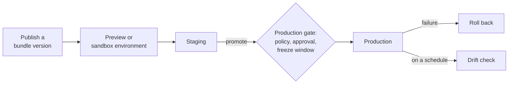

Massdriver models continuous delivery around the environment. A project's blueprint defines the components. Each environment of the project has one instance of each component, and the environment decides what reaches those instances: which bundle versions, which configuration, who can deploy, whether a change needs approval, and when changes are frozen.

A change reaches production by moving from one environment to the next. It can be a new bundle version, a configuration that was validated in another environment, or a whole new environment forked from an existing one. Every change runs as a deployment on an instance, with the instance's credentials and policy. No requester needs cloud credentials or a pipeline of their own.

## What an environment holds

| | Set on | Used for |
|---|---|---|
| Instances | The environment, one for each component | Params, version constraint, release strategy, secrets, and connections of each component |
| Environment defaults | The environment | Shared resources, such as a network, a cluster, or cloud credentials, that every instance in the environment connects to |
| Attributes | The project, the environment, and the component | Conditions of access policies, event destination filters, and automation opt-ins, such as `md-environment=prod` |
| Separation of duty | The environment | Requiring a second person to approve each proposal. Refer to [Separation of duty](/concepts/deployments#separation-of-duty). |
| Decommission protection | The environment | Refusing `decommissionEnvironment`, and every `DECOMMISSION` deployment of an instance in the environment |

Policies with an `md-environment` condition set what each group can do in each environment. A common setup lets developers deploy to `dev` and `staging` and propose in `prod`, where a release manager approves. Refer to [Access control](/platform-operations/security/access-control#common-patterns).

## How a change moves



1. **Publish.** `mass bundle publish` releases a bundle version. Instances on a release channel, such as `~1` or `latest`, deploy it. Other instances show it as an available upgrade. Refer to [Versions](/bundle-development/publishing/versioning#release-channels).
2. **Validate in a lower environment.** [Fork](/continuous-delivery/fork-environment) staging into a new environment, stand up a [preview environment](/continuous-delivery/preview) for each pull request, or give each developer a [sandbox](/continuous-delivery/automations/sandbox-on-join).
3. **Promote.** [`mass instance promote`](/continuous-delivery/promote) copies the validated params, version constraint, and release channel of an instance to the same component in the next environment, and plans the destination.
4. **Pass the environment's gate.** The deployment runs when the requester has `instance:deploy` in that environment. A requester with only `instance:propose` makes a proposal that someone with `instance:deploy` approves. Refer to [Two ways to deploy a change](/concepts/deployments#two-ways-to-deploy-a-change).
5. **Recover.** [Roll back](/continuous-delivery/rollback) an instance to a past deployment's bundle version, params, and connections.

## Primitives

Each step is one CLI command or one GraphQL mutation. Each is safe to run again, so a CI job or a script does not need to track what already ran.

| Step | CLI | Mutation |
|---|---|---|
| Fork an environment | `mass environment fork` | `forkEnvironment` |
| Create or update a preview environment | `mass environment preview` | `forkEnvironment`, `setEnvironmentDefault`, `copyInstance`, `deployEnvironment` |
| Compare two environments | `mass environment compare` | |
| Promote an instance's configuration | `mass instance promote` | `copyInstance` |
| Deploy an instance | `mass instance deploy` | `createDeployment` |
| Deploy every instance of an environment | `mass environment deploy` | `deployEnvironment` |
| Approve or reject a proposal | `mass deployment approve`, `mass deployment reject` | `approveDeployment`, `rejectDeployment` |
| Roll back an instance | `mass instance rollback` | `rollbackDeployment` |
| Tear down an environment | `mass environment decommission` | `decommissionEnvironment` |

`forkEnvironment` run again on an existing fork seeds it again. `setEnvironmentDefault` is an upsert. `copyInstance` deep-merges and plans. `deployEnvironment` and `decommissionEnvironment` cancel a rollout in progress and replace it.

```bash
mass environment fork ecomm-production pr42 --copy-environment-defaults
mass environment default ecomm-pr42 <shared-vpc-resource-id>
mass instance copy ecomm-production-db --to ecomm-pr42-db --copy-secrets
mass environment deploy ecomm-pr42
```

## Automations

Every change above writes an event to the audit log. [Automations](/continuous-delivery/automations) are small services that receive those events through an [event destination](/platform-operations/event-destinations) and act on them with a service account: approve proposals from Slack, freeze production on weekends, deploy dependents after an upstream change, roll back a failed deployment, or check for drift.

| Stage | Automations |
|---|---|
| Publish | [release-notes](/continuous-delivery/automations/release-notes), [bundle-scanner](/continuous-delivery/automations/bundle-scanner) |
| Environments | [sandbox-on-join](/continuous-delivery/automations/sandbox-on-join) |
| Gate | [proposal-chatops](/continuous-delivery/automations/proposal-chatops), [freeze-guard](/continuous-delivery/automations/freeze-guard) |
| Deploy | [autodeploy-downstream](/continuous-delivery/automations/autodeploy-downstream), [github-deployments](/continuous-delivery/automations/github-deployments) |
| Recover | [rollback-on-failure](/continuous-delivery/automations/rollback-on-failure), [drift](/continuous-delivery/automations/drift) |
| Report | [statuspage](/continuous-delivery/automations/statuspage), [audit-archiver](/continuous-delivery/automations/audit-archiver) |
| Anything else | [router](/continuous-delivery/automations/router), or [write your own](/continuous-delivery/automations#write-an-automation) |
