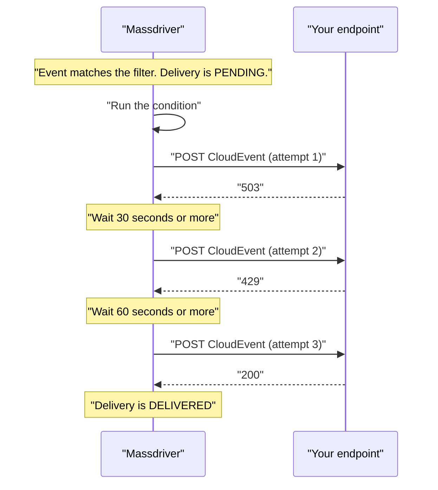
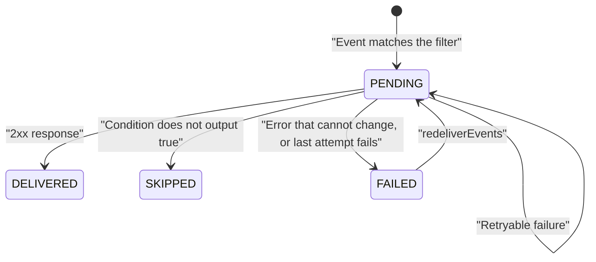

An event destination is an HTTP endpoint that receives your organization's audit log events. Massdriver sends each event that matches the destination's filter to the endpoint as a signed [CloudEvent](https://cloudevents.io).

To add, change, pause, or delete a destination, use the [event destination API](/api/graphql/operations/mutations/create-event-destination). To select events, use the [filter](/api/graphql/types/inputs/event-filter-input) and the [jq condition](/api/graphql/types/inputs/create-event-destination-input#condition). To manage destinations, a person or service account needs the `organization:manageEventDestinations` permission. Refer to [GraphQL permissions](/platform-operations/security/graphql-permissions#event-destination).

## How delivery works

1. An event occurs in your organization. Massdriver records it in the audit log.
2. Massdriver compares the event to the filter of each active destination. For each destination whose filter matches, Massdriver queues a delivery with the status `PENDING`. A paused destination does not get new deliveries.
3. Massdriver sends the due deliveries of a destination one at a time, oldest first.
4. Before each send, Massdriver runs the destination's condition, if it has one. If the condition does not output `true`, the delivery is `SKIPPED` and Massdriver does not send it.
5. Massdriver sends the event to your endpoint.
6. If your endpoint accepts the event, the delivery is `DELIVERED`. If the send fails with an error that can change, Massdriver sends the event again later, with a longer wait after each failure. If the send fails with an error that cannot change, or every attempt fails, the delivery is `FAILED`.

Massdriver runs the condition when it sends the event, not when it queues the delivery. If you change the condition, the new condition applies to deliveries that are still `PENDING`.



### Order and duplicates

Massdriver does not guarantee the order of events. A delivery that waits for a retry goes behind deliveries that are due before it.

Massdriver delivers each event at least once. Your endpoint can receive the same event more than one time. For example, this occurs when your endpoint accepts an event but the response does not get back to Massdriver. Each event has a unique `id`. Every attempt for an event sends the same `id`. Use the `id` to find and drop duplicates.

## The request

Massdriver sends a `POST` request to the `url` in the destination's `config`. The body is one CloudEvent in JSON structured mode.

| Header | Value |
|---|---|
| `content-type` | `application/cloudevents+json` |
| `webhook-id` | The CloudEvent `id`. It is the same for every attempt of the event. |
| `webhook-timestamp` | The time of this attempt, in seconds since the Unix epoch. It changes for each attempt. |
| `webhook-signature` | `v1,` followed by the base64 signature of the request. Refer to [Verify the signature](#verify-the-signature). |

### Custom headers

You can add headers to the destination's `config.headers`, for example a token that your endpoint requires. Massdriver sends them with each request. Massdriver changes header names to lowercase. If a custom header has the same name as one of the headers in the table above, Massdriver sends its own value and ignores your value.

Custom headers can hold credentials. The `event_destination.*` audit log events do not include the destination's `config` or signing secret.

### The body

| Field | Value |
|---|---|
| `specversion` | `1.0` |
| `id` | The unique identifier of the event. |
| `source` | The URL of the Massdriver installation that recorded the event. |
| `type` | The event type, such as `deployment.completed`. The [`eventTypes`](/api/graphql/operations/queries/event-types) query lists all event types. |
| `subject` | The Massdriver resource identifier of the entity that the event is about. |
| `time` | When the event occurred (UTC, ISO 8601). |
| `datacontenttype` | `application/json` |
| `data` | The entity that the event is about, and the context of the event. |

Massdriver adds two objects to `data`:

- `data.metadata`: facts about the event, such as how the actor authenticated. Refer to [`metadata`](/api/graphql/types/inputs/event-filter-input#metadata) for the fields.
- `data.attributes`: the attributes that the entity had when the event occurred, including the system attributes (`md-*`). Refer to [`attributes`](/api/graphql/types/inputs/event-filter-input#attributes).

When a person, a service account, or a deployment caused the event, `data.context` holds the IDs of the organization and the actor. When Massdriver caused the event, `data` has no `context`.

This is a `deployment.completed` event:

```json
{
  "specversion": "1.0",
  "id": "0b6f1e9c-3f4a-4c55-9d0e-8a2f6b1c7d42",
  "source": "https://app.massdriver.cloud",
  "type": "deployment.completed",
  "subject": "mri:acme:api:prod:deployment:5c1de0a7-92b4-4f1e-8d3a-6e27c9f0b815",
  "time": "2026-11-19T15:04:11.482913Z",
  "datacontenttype": "application/json",
  "data": {
    "resource": {
      "id": "5c1de0a7-92b4-4f1e-8d3a-6e27c9f0b815",
      "status": "COMPLETED",
      "action": "PROVISION",
      "version": "1.4.2",
      "message": null,
      "tags": {},
      "deployed_by_name": "Jane Doe",
      "deployed_by_account_id": "8d2f4c61-7a0e-4b9d-9c53-1f6a2e8b4d07",
      "deployed_by_service_account_id": null,
      "package_id": "e4a7b2c9-15d3-4f86-a0b1-9c3e5d7f2a68",
      "bundle_id": "3f9a6c1e-8b2d-4e7a-b5c4-0d1e2f3a4b5c",
      "rollback_of_deployment_id": null,
      "last_transitioned_at": "2026-11-19T15:04:11Z",
      "logs_compacted_at": null,
      "created_at": "2026-11-19T14:58:02.104371Z",
      "updated_at": "2026-11-19T15:04:11.471205Z"
    },
    "metadata": {
      "credential": "system",
      "deployment_action": "PROVISION"
    },
    "attributes": {
      "md-id": "5c1de0a7-92b4-4f1e-8d3a-6e27c9f0b815",
      "md-project": "api",
      "md-environment": "prod",
      "md-component": "database",
      "md-instance": "api-prod-database",
      "md-repo": "aws-rds-postgres",
      "md-bundle": "aws-rds-postgres@1.4.2"
    }
  }
}
```

## Verify the signature

Massdriver signs each request with the [Standard Webhooks](https://www.standardwebhooks.com) method. Each HTTP destination has its own signing secret. Get it from the [`signingSecret`](/api/graphql/types/objects/event-destination#signing-secret) field of the destination. The secret has the form `whsec_` followed by base64.

The signature is the HMAC-SHA256 of `<webhook-id>.<webhook-timestamp>.<body>`. The key is the base64-decoded part of the secret after `whsec_`. The `webhook-signature` header holds `v1,` followed by the base64 of the signature.

To verify a request:

1. Read the raw request body. Do not parse and encode the JSON again before you verify it.
2. Make sure that `webhook-timestamp` is near your current time. The Standard Webhooks specification recommends a tolerance of 5 minutes. This stops replay of old requests.
3. Calculate the signature and compare it to each `v1` value in `webhook-signature`. Use a constant-time comparison.
4. If no value is equal, refuse the request.

The Standard Webhooks project has [libraries](https://github.com/standard-webhooks/standard-webhooks/tree/main/libraries) for many languages that do these steps. This Python function does the same steps with the standard library:

```python
import base64
import hashlib
import hmac
import time

TOLERANCE_SECONDS = 5 * 60


def verify(secret: str, headers: dict, body: bytes) -> bool:
    msg_id = headers["webhook-id"]
    timestamp = headers["webhook-timestamp"]

    if abs(time.time() - int(timestamp)) > TOLERANCE_SECONDS:
        return False

    key = base64.b64decode(secret.removeprefix("whsec_"))
    signed = f"{msg_id}.{timestamp}.".encode() + body
    expected = base64.b64encode(hmac.new(key, signed, hashlib.sha256).digest()).decode()

    for signature in headers["webhook-signature"].split(" "):
        version, _, value = signature.partition(",")
        if version == "v1" and hmac.compare_digest(value, expected):
            return True

    return False
```

## Responses and retries

Massdriver waits 10 seconds for a response. Massdriver does not follow redirects.

| Result | What Massdriver does |
|---|---|
| `2xx` | The delivery is `DELIVERED`. |
| `408`, `429`, `5xx` | Massdriver sends the event again later. |
| No response in 10 seconds, connection error, or the host does not resolve | Massdriver sends the event again later. |
| Any other status, including `3xx` redirects and other `4xx` | The delivery is `FAILED` at once. |
| The host is a private address | The delivery is `FAILED` at once. Refer to [Private addresses](#private-addresses). |

The delivery's `lastError` field tells you why the last attempt failed, for example `HTTP 503`.

### Retry schedule

After a failed attempt, Massdriver waits `30 seconds × 2^(attempt − 1)`, with a maximum of 1 hour. Massdriver adds a random 0% to 20% to each wait, so that retries from many deliveries do not occur at the same time. With the default of 10 attempts:

| Failed attempt | Wait before the next attempt |
|---|---|
| 1 | 30 seconds |
| 2 | 1 minute |
| 3 | 2 minutes |
| 4 | 4 minutes |
| 5 | 8 minutes |
| 6 | 16 minutes |
| 7 | 32 minutes |
| 8 | 1 hour |
| 9 | 1 hour |
| 10 | None. The delivery is `FAILED`. |

When an attempt fails with an error that can change, Massdriver stops sending to that destination until the next run. A new run starts when a new event matches the destination. Massdriver also starts a run once a minute for each destination that has due deliveries. Thus a retry can start up to one minute after its wait ends, and an endpoint that is down gets one request in each run.

## Delivery statuses



| Status | Meaning |
|---|---|
| `PENDING` | The delivery waits to be sent, or waits for a retry. |
| `DELIVERED` | Your endpoint accepted the event. |
| `SKIPPED` | The destination's condition did not output `true` for the event. Massdriver did not send it. |
| `FAILED` | Massdriver stopped trying. |

A delivery is `FAILED` when one of these occurs:

- Your endpoint returned a status that Massdriver does not retry.
- The host is a private address.
- The last attempt failed.
- The condition did not finish in time, or jq could not run it on the event.
- The audit log event no longer exists.

To see the deliveries of a destination, query the `deliveries` field of [`eventDestination`](/api/graphql/operations/queries/event-destination). You can filter deliveries by status.

### Send failed events again

Use [`redeliverEvents`](/api/graphql/operations/mutations/redeliver-events) to send `FAILED` deliveries again. Massdriver sets each delivery to `PENDING`, sets its attempt count to 0, and sends it at once. Each delivery gets all its attempts again.

- To send every failed delivery of a destination again, leave out `deliveryIds`.
- To send some failed deliveries again, give their IDs in `deliveryIds`. Massdriver does not change deliveries that are not `FAILED`.

If the destination is paused, Massdriver sends the deliveries after you resume it.

## Automatic pause

When a send to a destination fails, Massdriver records the time in the destination's [`failingSince`](/api/graphql/types/objects/event-destination#failing-since) field. A successful send clears `failingSince`.

If a send fails and `failingSince` is 24 hours or more in the past, Massdriver pauses the destination. Thus Massdriver pauses a destination that has no successful send for 24 hours. Self-hosted installations can change this time with `MD_EVENT_DESTINATIONS_PAUSE_AFTER_HOURS`.

Failures from the condition do not set `failingSince`. They are about the condition, not about your endpoint.

When Massdriver pauses a destination, it records an `event_destination.paused` event. To be told when this occurs, send `event_destination.paused` events to a different destination.

While a destination is paused:

- Massdriver does not queue deliveries for new events. Massdriver does not send these events after you resume the destination.
- Deliveries that were `PENDING` stay `PENDING`.

To resume a destination, first repair your endpoint. Then use [`resumeEventDestination`](/api/graphql/operations/mutations/resume-event-destination). Massdriver clears `failingSince` and starts to send the `PENDING` deliveries at once. Failures before the pause do not count toward the next pause.

You can also pause a destination yourself with [`pauseEventDestination`](/api/graphql/operations/mutations/pause-event-destination).

## Private addresses

Massdriver refuses to send events to private addresses. Before each send, Massdriver resolves the host of the URL. If one or more of its addresses is private, the delivery is `FAILED` at once. These addresses are private:

- IPv4: `0.0.0.0/8`, `10.0.0.0/8`, `100.64.0.0/10`, `127.0.0.0/8`, `169.254.0.0/16`, `172.16.0.0/12`, `192.0.0.0/24`, `192.168.0.0/16`, `198.18.0.0/15`, and all addresses from `224.0.0.0` up.
- IPv6: `fc00::/7`, `fe80::/10`, `ff00::/8`, and Teredo (`2001::/32`).
- IPv6 addresses that hold a private IPv4 address: IPv4-compatible (`::/96`, which includes `::` and `::1`), IPv4-mapped (`::ffff:0:0/96`), 6to4 (`2002::/16`), and NAT64 (`64:ff9b::/96`).

Massdriver does not check the address when you add the destination. It checks the address at each send.

A self-hosted installation can allow private addresses with `MD_EVENT_DESTINATIONS_ALLOW_PRIVATE_ADDRESSES`.

## Delivery history

Massdriver deletes old deliveries:

- `DELIVERED` and `SKIPPED` deliveries after 7 days.
- `FAILED` deliveries after 30 days.
- `PENDING` deliveries that were due more than 30 days ago. These are deliveries of a destination that has been paused for that long.

The `event` field of a delivery is `null` when the audit log no longer keeps the event.

## Self-hosted settings

Self-hosted installations can change event delivery with these environment variables on the Massdriver server.

| Variable | Default | What it changes |
|---|---|---|
| `MD_EVENT_DESTINATIONS_MAX_ATTEMPTS` | `10` | The number of attempts for each delivery. After this number of failed attempts, the delivery is `FAILED`. |
| `MD_EVENT_DESTINATIONS_PAUSE_AFTER_HOURS` | `24` | The number of hours without a successful send after which Massdriver pauses a destination. |
| `MD_EVENT_DESTINATIONS_DELIVERED_RETENTION_DAYS` | `7` | The number of days that Massdriver keeps `DELIVERED` and `SKIPPED` deliveries. |
| `MD_EVENT_DESTINATIONS_FAILED_RETENTION_DAYS` | `30` | The number of days that Massdriver keeps `FAILED` deliveries, and `PENDING` deliveries that are past due. |
| `MD_EVENT_DESTINATIONS_CONDITION_TIMEOUT_MS` | `1000` | The time in milliseconds that a condition can run on one event. A condition that runs longer makes the delivery `FAILED`. |
| `MD_EVENT_DESTINATIONS_ALLOW_PRIVATE_ADDRESSES` | `false` | When `true`, Massdriver sends events to private addresses. Set it when your destinations are on an internal network. |
