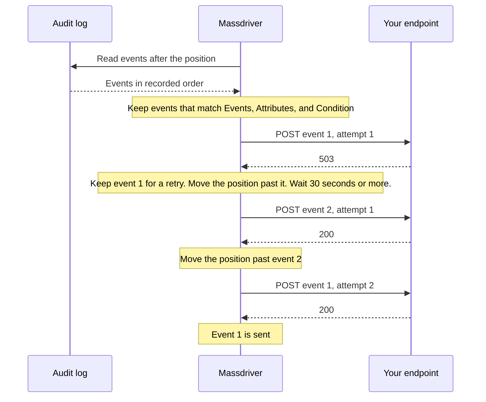

An event destination is an HTTP endpoint that receives your organization's audit log events. You choose the events that the destination receives. Massdriver sends each of these events to the endpoint as a signed [CloudEvent](https://cloudevents.io).

To manage destinations, a person or service account needs the `organization:manageEventDestinations` permission. Refer to [GraphQL permissions](/platform-operations/security/graphql-permissions#event-destination).

## Add a destination

### In the Massdriver UI

1. Go to **Organization Settings** → **Event destinations**.
2. Click **New destination**.
3. Enter a **Name** and the **URL** of your endpoint.
4. Optional: add **Headers** that Massdriver sends with each request. Put credentials, such as an `Authorization` header, in **Credentials**, not in **Headers**.
5. Choose the **Events**. If necessary, add **Attributes** and a **Condition** under **Filters**. Refer to [Choose events](#choose-events).
6. Click **Create destination**.

The destination opens on its **Overview** tab. The **Overview** tab shows the signing secret. Refer to [Verify the signature](#verify-the-signature). The **Undelivered events** tab shows the events that wait for a retry and the events that Massdriver could not send. The **Settings** tab changes the destination.

### With the API

Use [`createEventDestination`](/api/graphql/operations/mutations/create-event-destination). Pass `auth` as a variable, because query text can appear in request traces and variables do not.

```graphql
mutation CreateEventDestination($auth: Map) {
  createEventDestination(
    organizationId: "my-org"
    input: {
      name: "Production deployments"
      adapter: HTTP
      config: "{\"url\": \"https://hooks.example.com/massdriver\"}"
      auth: $auth
      eventTypes: ["deployment.*"]
      attributes: "{\"md-environment\": \"prod\"}"
      condition: ".data.metadata.deployment_action == \"PROVISION\""
    }
  ) {
    result { id signingSecret }
    successful
    messages { field message }
  }
}
```

```json
{
  "auth": "{\"headers\": {\"Authorization\": \"Bearer <token>\"}}"
}
```

To change a destination, use [`updateEventDestination`](/api/graphql/operations/mutations/update-event-destination). To delete it, use [`deleteEventDestination`](/api/graphql/operations/mutations/delete-event-destination).

### Settings and credentials

Each destination has an adapter. The adapter sets how Massdriver sends events. A destination has two objects of adapter settings:

- `config`: the settings, such as the URL. The API returns `config`.
- `auth`: the credentials, such as an `Authorization` header. The API never returns `auth`. To remove the credentials, set `auth` to `null`.

The [`eventDestinationAdapters`](/api/graphql/operations/queries/event-destination-adapters) query lists each adapter. For each adapter, `configSchema` and `authSchema` are the JSON schemas of `config` and `auth`, and `signs` tells you if Massdriver signs the events.

The `HTTP` adapter takes these settings:

| Object | Field | Value |
|---|---|---|
| `config` | `url` | The URL that receives the events. It must start with `http://` or `https://` and include a host. Required. |
| `config` | `headers` | Header names and values that Massdriver sends with each request. Do not put credentials here. |
| `auth` | `headers` | Header names and values that hold credentials, such as `Authorization`. Massdriver sends them with each request. |

When you save a destination, Massdriver refuses a URL whose host is a private address. Refer to [Private addresses](#private-addresses).

## Choose events

Three settings choose the events that a destination receives. Massdriver applies them in this order:

1. **Events** (`eventTypes`): a list of event types, such as `deployment.failed`. To select all the event types of one entity, use `<entity>.*`, such as `deployment.*`. An empty list selects every event. The [`eventTypes`](/api/graphql/operations/queries/event-types) query lists all event types.
2. **Attributes** (`attributes`): an optional map of attribute keys to values, such as `{"md-environment": "prod"}`. Each key has one value. Massdriver keeps an event only when the entity that the event is about had every key with exactly that value when the event occurred. An empty map (`{}`) keeps every event.
3. **Condition** (`condition`): an optional [jq](https://jqlang.org) expression. Massdriver runs the condition on each event that **Events** and **Attributes** keep. Massdriver sends the event only when the condition outputs `true`.

Use **Attributes** for a match on one value for each key. Use the **Condition** for other logic, such as one of two values.

In `updateEventDestination`, a new `attributes` map replaces the old map. To remove all the attributes, set `attributes` to `{}`. If you do not include `attributes`, the destination keeps its attributes.

The condition gets the whole event, as shown in [The body](#the-body). The most useful fields are:

- `.data.attributes`: the attributes that the entity had when the event occurred, including the system attributes (`md-*`), such as `md-project` and `md-environment`.
- `.data.metadata`: facts about the event, such as how the actor authenticated. Each event type lists its metadata fields in the `metadata` field of the [`eventTypes`](/api/graphql/types/objects/event-type#metadata) query.

| To send | Events | Attributes | Condition |
|---|---|---|---|
| Every event | (empty) | (empty) | (empty) |
| Events in production environments | (empty) | `{"md-environment": "prod"}` | (empty) |
| Deployments that failed | `deployment.failed` | (empty) | (empty) |
| Resource exports that reveal a secret | `resource.exported` | (empty) | `.data.metadata.contains_secrets == true` |
| Events in one project | (empty) | `{"md-project": "api"}` | (empty) |
| Events in production or staging environments | (empty) | (empty) | `.data.attributes["md-environment"] == "prod" or .data.attributes["md-environment"] == "staging"` |

A condition must finish within 1 second on one event. Self-hosted installations can change this time with `MD_EVENT_DESTINATIONS_CONDITION_TIMEOUT_MS`. It cannot use `import`, `include`, `module`, `modulemeta`, or `get_search_list`.

The UI shows recent events that match the **Events**, **Attributes**, and **Condition** while you edit them. With the API, use [`previewEventDestination`](/api/graphql/operations/queries/preview-event-destination). It returns the error `eventTypes: <type> is not an event type` for an event type that does not exist, `attributes: <message>` for attributes that are not valid, and `condition: <message>` for a condition that jq cannot run.

## How delivery works

1. An event occurs in your organization. Massdriver records it in the audit log.
2. Each destination keeps its position in your organization's audit log. A new destination starts at the time you create it. It does not get older events.
3. For each active destination, Massdriver reads the events after the position, in the order that Massdriver recorded them.
4. Massdriver keeps the events whose type matches **Events** and whose entity had the **Attributes**. Then Massdriver runs the **Condition** on them.
5. Massdriver sends each event that passes to your endpoint, one at a time.
6. Massdriver moves the position past each event it is done with. An event that your endpoint cannot take now waits for a retry, and the position also moves past it.

Massdriver sends an event as soon as the change that caused it is saved, usually in less than a second. One Massdriver server sends to a destination at a time.

Massdriver reads only events whose database transaction is older than every transaction that is still running. Thus Massdriver does not skip an event that is recorded late.



### Order and duplicates

Massdriver sends the events of a destination in the order that it recorded them, with one exception: an event that Massdriver retries, or that you send again with [`redeliverEvents`](#failed-events), arrives after newer events. Use the event `time` when order matters.

Massdriver delivers each event at least once. Your endpoint can receive the same event more than one time. For example, this occurs when your endpoint accepts an event but the response does not get back to Massdriver. Each event has a unique `id`. Every attempt for an event sends the same `id`. Use the `id` to find and drop duplicates.

## The request

Massdriver sends a `POST` request to the `url` in the destination's `config`. The body is one CloudEvent in JSON structured mode.

| Header | Value |
|---|---|
| `content-type` | `application/cloudevents+json` |
| `webhook-id` | The CloudEvent `id`. It is the same for every attempt of the event. |
| `webhook-timestamp` | The time of this attempt, in seconds since the Unix epoch. It changes for each attempt. |
| `webhook-signature` | `v1,` followed by the base64 signature of the request. Refer to [Verify the signature](#verify-the-signature). |

### Custom headers

Massdriver sends the headers in `config.headers` and `auth.headers` with each request. Massdriver changes header names to lowercase. If a header in `auth.headers` has the same name as a header in `config.headers`, Massdriver sends the value from `auth.headers`.

If a custom header has the same name as one of the headers in the table above, Massdriver sends its own value and ignores your value. Massdriver does not send a custom `host` header. The `host` header always names the host of the URL.

The `event_destination.*` audit log events do not include the destination's `config`, `auth`, or signing secret.

### The body

| Field | Value |
|---|---|
| `specversion` | `1.0` |
| `id` | The unique identifier of the event. |
| `source` | The URL of the Massdriver installation that recorded the event. |
| `type` | The event type, such as `deployment.completed`. The [`eventTypes`](/api/graphql/operations/queries/event-types) query lists all event types. |
| `subject` | The Massdriver resource identifier of the entity that the event is about. |
| `time` | When the event occurred (UTC, ISO 8601). |
| `datacontenttype` | `application/json` |
| `data` | `entity`, the entity that the event is about, and `actor`, the actor that caused the event. |

Massdriver adds two objects to `data`:

- `data.metadata`: facts about the event, such as how the actor authenticated. The [`eventTypes`](/api/graphql/types/objects/event-type#metadata) query lists the metadata fields of each event type.
- `data.attributes`: the attributes that the entity had when the event occurred, including the system attributes (`md-*`).

When a person, a service account, or a deployment caused the event, `data.actor` holds the IDs of the organization and the actor. When Massdriver caused the event, `data` has no `actor`.

This is a `deployment.completed` event:

```json
{
  "specversion": "1.0",
  "id": "0b6f1e9c-3f4a-4c55-9d0e-8a2f6b1c7d42",
  "source": "https://app.massdriver.cloud",
  "type": "deployment.completed",
  "subject": "mri:acme:api:prod:deployment:5c1de0a7-92b4-4f1e-8d3a-6e27c9f0b815",
  "time": "2026-11-19T15:04:11.482913Z",
  "datacontenttype": "application/json",
  "data": {
    "entity": {
      "id": "5c1de0a7-92b4-4f1e-8d3a-6e27c9f0b815",
      "status": "COMPLETED",
      "action": "PROVISION",
      "version": "1.4.2",
      "message": null,
      "tags": {},
      "deployed_by_name": "Jane Doe",
      "deployed_by_account_id": "8d2f4c61-7a0e-4b9d-9c53-1f6a2e8b4d07",
      "deployed_by_service_account_id": null,
      "package_id": "e4a7b2c9-15d3-4f86-a0b1-9c3e5d7f2a68",
      "bundle_id": "3f9a6c1e-8b2d-4e7a-b5c4-0d1e2f3a4b5c",
      "rollback_of_deployment_id": null,
      "last_transitioned_at": "2026-11-19T15:04:11Z",
      "logs_compacted_at": null,
      "created_at": "2026-11-19T14:58:02.104371Z",
      "updated_at": "2026-11-19T15:04:11.471205Z"
    },
    "metadata": {
      "credential": "system",
      "deployment_action": "PROVISION"
    },
    "attributes": {
      "md-id": "5c1de0a7-92b4-4f1e-8d3a-6e27c9f0b815",
      "md-project": "api",
      "md-environment": "prod",
      "md-component": "database",
      "md-instance": "api-prod-database",
      "md-repo": "aws-rds-postgres",
      "md-bundle": "aws-rds-postgres@1.4.2"
    }
  }
}
```

## Verify the signature

Massdriver signs each request with the [Standard Webhooks](https://www.standardwebhooks.com) method. Each HTTP destination has its own signing secret. Get it from the **Overview** tab of the destination, or from the [`signingSecret`](/api/graphql/types/objects/event-destination#signing-secret) field. The secret has the form `whsec_` followed by base64.

The signature is the HMAC-SHA256 of `<webhook-id>.<webhook-timestamp>.<body>`. The key is the base64-decoded part of the secret after `whsec_`. The `webhook-signature` header holds `v1,` followed by the base64 of the signature.

To verify a request:

1. Read the raw request body. Do not parse and encode the JSON again before you verify it.
2. Make sure that `webhook-timestamp` is near your current time. The Standard Webhooks specification recommends a tolerance of 5 minutes. This stops replay of old requests.
3. Calculate the signature and compare it to each `v1` value in `webhook-signature`. Use a constant-time comparison.
4. If no value is equal, refuse the request.

The Standard Webhooks project has [libraries](https://github.com/standard-webhooks/standard-webhooks/tree/main/libraries) for many languages that do these steps. This Python function does the same steps with the standard library:

```python
import base64
import hashlib
import hmac
import time

TOLERANCE_SECONDS = 5 * 60


def verify(secret: str, headers: dict, body: bytes) -> bool:
    msg_id = headers["webhook-id"]
    timestamp = headers["webhook-timestamp"]

    if abs(time.time() - int(timestamp)) > TOLERANCE_SECONDS:
        return False

    key = base64.b64decode(secret.removeprefix("whsec_"))
    signed = f"{msg_id}.{timestamp}.".encode() + body
    expected = base64.b64encode(hmac.new(key, signed, hashlib.sha256).digest()).decode()

    for signature in headers["webhook-signature"].split(" "):
        version, _, value = signature.partition(",")
        if version == "v1" and hmac.compare_digest(value, expected):
            return True

    return False
```

## Responses and retries

Massdriver waits 10 seconds for a response. Massdriver does not follow redirects.

| Result | What Massdriver does |
|---|---|
| `2xx` | The event is sent. Massdriver continues with the next event. |
| `408`, `429`, `5xx` | Massdriver keeps the event to send again later, and waits before it sends to the destination again. |
| No response in 10 seconds, connection error, or the host does not resolve | Massdriver keeps the event to send again later, and waits before it sends to the destination again. |
| Any other status, including `3xx` redirects and other `4xx` | The event becomes a failed event at once. Massdriver continues with the next event. |
| The host is a private address | The event becomes a failed event at once. Massdriver continues with the next event. Refer to [Private addresses](#private-addresses). |
| The condition does not finish in time, or jq cannot run it on the event | The event becomes a failed event at once. Massdriver continues with the next event. |

The destination's `lastError` field tells you why the last send failed, for example `HTTP 503`. A successful send clears it. The `lastDeliveredAt` field tells you when your endpoint last accepted an event.

### Retry schedule

After a failed attempt, Massdriver waits `30 seconds × 2^(attempt − 1)`, with a maximum of 1 hour. Massdriver adds a random 0% to 20% to each wait, so that retries from many destinations do not occur at the same time. With the default of 10 attempts:

| Failed attempt | Wait before the next attempt |
|---|---|
| 1 | 30 seconds |
| 2 | 1 minute |
| 3 | 2 minutes |
| 4 | 4 minutes |
| 5 | 8 minutes |
| 6 | 16 minutes |
| 7 | 32 minutes |
| 8 | 1 hour |
| 9 | 1 hour |
| 10 | None. The event becomes a failed event and Massdriver continues with the next event. |

After a failed attempt, Massdriver also waits before it sends any event to the destination, by the same schedule, counted in failed attempts in a row. One successful send ends the wait. Thus an endpoint that is down gets one request for each wait, not one for each event. An event that your endpoint cannot take does not hold back the events after it.

## Failed events

A failed event is an event that Massdriver could not send. The **Undelivered events** tab of a destination lists them, with the events that wait for a retry. With the API, query the `deliveries` field of [`eventDestination`](/api/graphql/operations/queries/event-destination). The field holds only events that wait for a retry and failed events. Massdriver stores nothing for an event that it sent.

| Status | Meaning |
|---|---|
| `FAILED` | Massdriver stopped trying to send the event. |
| `PENDING` | The event waits for a retry, or you sent it again. Massdriver sends it at `nextAttemptAt`. |

The `lastError` field of a failed event tells you why the last attempt failed. The `event` field is `null` when the audit log no longer keeps the event.

### Send failed events again

On the **Undelivered events** tab, send one failed event again, or send all of them again. With the API, use [`redeliverEvents`](/api/graphql/operations/mutations/redeliver-events):

- To send every failed event of a destination again, leave out `deliveryIds`.
- To send some failed events again, give their IDs in `deliveryIds`. Massdriver does not change deliveries that are not `FAILED`.

Massdriver sets each event to `PENDING` and sets its attempt count to 0. Massdriver sends these events before new events. Each event gets all its attempts again. If the destination is paused, Massdriver sends them after you resume it.

Massdriver records an `event_destination.redelivered` audit log event each time you use `redeliverEvents`.

## Pause and resume

To pause a destination, click **Pause** on the destination, or use [`pauseEventDestination`](/api/graphql/operations/mutations/pause-event-destination). While a destination is paused, Massdriver sends no events to it. The destination keeps its position in the audit log.

To resume a destination, click **Resume**, or use [`resumeEventDestination`](/api/graphql/operations/mutations/resume-event-destination). Massdriver continues from the position. Thus Massdriver sends the events that it recorded while the destination was paused, in order.

### Automatic pause

When a send to a destination fails, Massdriver records the time in the destination's [`failingSince`](/api/graphql/types/objects/event-destination#failing-since) field. All failures count: failures that Massdriver retries, failures that make an event fail at once, and condition errors. One successful send clears `failingSince`.

If a send fails and `failingSince` is 24 hours or more in the past, Massdriver pauses the destination. Thus Massdriver pauses a destination that has no successful send for 24 hours. A destination that refuses every event is paused in the same way as a destination that is down. Self-hosted installations can change this time with `MD_EVENT_DESTINATIONS_PAUSE_AFTER_HOURS`.

Failures from the condition do not set `failingSince`. They are about the condition, not about your endpoint.

When Massdriver pauses a destination, it records an `event_destination.paused` event. To be told when this occurs, send `event_destination.paused` events to a different destination.

To resume a destination after an automatic pause, first repair your endpoint. Then resume the destination. Massdriver clears `failingSince`. Failures before the pause do not count toward the next pause.

## Private addresses

Massdriver refuses to send events to private addresses. Massdriver checks the host of the URL at two times:

- When you save a destination, Massdriver refuses a URL whose host is a private address. Massdriver accepts a host that does not resolve yet.
- Before each send, Massdriver resolves the host again. If one or more of its addresses is private, the event becomes a failed event at once. Massdriver sends the request to the address that it checked.

These addresses are private:

- IPv4: `0.0.0.0/8`, `10.0.0.0/8`, `100.64.0.0/10`, `127.0.0.0/8`, `169.254.0.0/16`, `172.16.0.0/12`, `192.0.0.0/24`, `192.168.0.0/16`, `198.18.0.0/15`, and all addresses from `224.0.0.0` up.
- IPv6: `fc00::/7`, `fe80::/10`, `ff00::/8`, and Teredo (`2001::/32`).
- IPv6 addresses that hold a private IPv4 address: IPv4-compatible (`::/96`, which includes `::` and `::1`), IPv4-mapped (`::ffff:0:0/96`), 6to4 (`2002::/16`), and NAT64 (`64:ff9b::/96`).

A self-hosted installation can allow private addresses with `MD_EVENT_DESTINATIONS_ALLOW_PRIVATE_ADDRESSES`.

## Self-hosted settings

Self-hosted installations can change event delivery with these environment variables on the Massdriver server.

| Variable | Default | What it changes |
|---|---|---|
| `MD_EVENT_DESTINATIONS_MAX_ATTEMPTS` | `10` | The number of attempts for each event. After this number of failed attempts, the event becomes a failed event. |
| `MD_EVENT_DESTINATIONS_PAUSE_AFTER_HOURS` | `24` | The number of hours without a successful send after which Massdriver pauses a destination. |
| `MD_EVENT_DESTINATIONS_FAILED_RETENTION_DAYS` | `30` | The number of days that Massdriver keeps failed events. |
| `MD_EVENT_DESTINATIONS_CONDITION_TIMEOUT_MS` | `1000` | The time in milliseconds that a condition can run on one event. A condition that runs longer makes the event fail. |
| `MD_EVENT_DESTINATIONS_ALLOW_PRIVATE_ADDRESSES` | `false` | When `true`, Massdriver accepts and sends events to private addresses. Set it when your destinations are on an internal network. |
