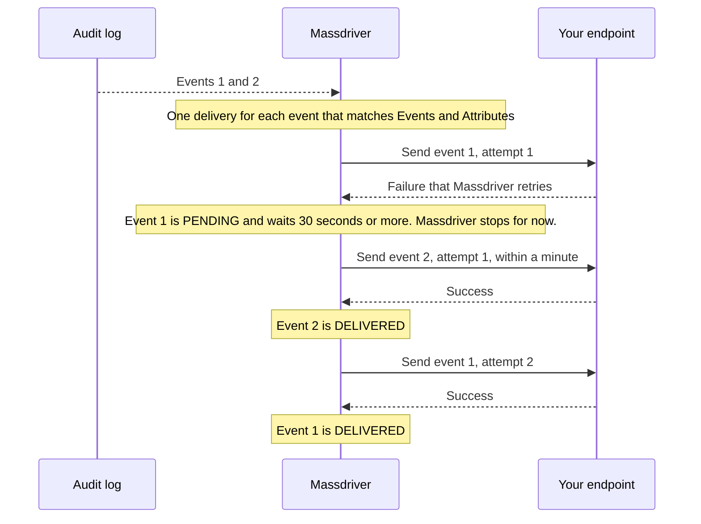

An event destination receives your organization's audit log events. You choose the events that the destination receives. Each destination has an adapter. The adapter sets where and how Massdriver sends the events.

| Adapter | Sends each event |
|---|---|
| [HTTP](/platform-operations/event-destinations/http) | As a signed [CloudEvent](https://cloudevents.io) in a `POST` request to your URL. |
| [Slack](/platform-operations/event-destinations/slack) | As a message in a Slack channel, with the bot token of your Slack app. |
| [ServiceNow](/platform-operations/event-destinations/servicenow) | As a new record, such as an incident, in a ServiceNow table. |
| [PagerDuty](/platform-operations/event-destinations/pagerduty) | As an alert on a PagerDuty service, with the Events API v2. |

To manage destinations, a person or service account needs the `organization:manageEventDestinations` permission. Refer to [GraphQL permissions](/platform-operations/security/graphql-permissions#event-destination).

To act on events, such as to approve proposals from Slack or roll back a failed deployment, run an [automation](/continuous-delivery/automations) behind an HTTP destination.

## Add a destination

### In the Massdriver UI

1. Go to **Organization Settings** → **Event destinations**.
2. Click **New destination**.
3. Select the adapter. Enter a **Name** and the settings of the adapter, such as the **URL** of your endpoint.
4. Optional: add the credentials of the adapter under **Credentials**, such as an `Authorization` header.
5. Choose the **Events**. If necessary, add **Attributes** and a **Condition** under **Filters**. Refer to [Choose events](#choose-events).
6. Click **Create destination**.

The destination opens on its **Overview** tab. For an adapter that signs events, the **Overview** tab shows the signing secret. The **Deliveries** tab shows each event that Massdriver gave the destination: delivered, waiting, skipped, or failed. The **Settings** tab changes the destination.

### With the API

Use [`createEventDestination`](/api/graphql/operations/mutations/create-event-destination). Pass `auth` as a variable, because query text can appear in request traces and variables do not.

```graphql
mutation CreateEventDestination($auth: Map) {
  createEventDestination(
    organizationId: "my-org"
    input: {
      name: "Production deployments"
      adapter: HTTP
      config: "{\"url\": \"https://hooks.example.com/massdriver\"}"
      auth: $auth
      eventTypes: ["deployment.*"]
      attributes: "{\"md-environment\": \"prod\"}"
      condition: ".data.metadata.deployment_action == \"PROVISION\""
    }
  ) {
    result { id signingSecret }
    successful
    messages { field message }
  }
}
```

```json
{
  "auth": "{\"headers\": {\"Authorization\": \"Bearer <token>\"}}"
}
```

To change a destination, use [`updateEventDestination`](/api/graphql/operations/mutations/update-event-destination). To delete it, use [`deleteEventDestination`](/api/graphql/operations/mutations/delete-event-destination). Deleting a destination deletes its deliveries. Events that wait to be sent are not sent.

### With the CLI

The `mass event destination` commands need [mass](/reference/cli/overview) 2.6.0 or later. Check the events of a destination before you create it:

```bash
mass event destination preview \
  --event-type 'deployment.*' \
  --attribute md-environment=prod \
  --condition '.data.metadata.deployment_action == "PROVISION"'
```

Create the destination. Put credentials in `--auth`, because the API returns the headers of `--header`:

```bash
mass event destination create \
  --name "Production deployments" \
  --url https://hooks.example.com/massdriver \
  --event-type 'deployment.*' \
  --attribute md-environment=prod \
  --auth @auth.json
```

List the failed deliveries of a destination, and send them again:

```bash
mass event destination deliveries 4f9b2c1e-8d3a-4c6e-9f1b-2a7d5e8c0b13 --status FAILED
mass event destination redeliver 4f9b2c1e-8d3a-4c6e-9f1b-2a7d5e8c0b13
```

`mass event type list` lists the event types. Run `mass event destination --help` for the other commands.

### Settings and credentials

A destination has two objects of adapter settings:

- `config`: the settings, such as the URL. The API returns `config`.
- `auth`: the credentials, such as an `Authorization` header. The API never returns `auth`. To remove the credentials, set `auth` to `null`.

The [`eventDestinationAdapters`](/api/graphql/operations/queries/event-destination-adapters) query lists each adapter. For each adapter, `configSchema` and `authSchema` are the JSON schemas of `config` and `auth`, and `signs` tells you if Massdriver signs the events. The page of each adapter lists its settings.

### Send a test event

To check the settings and credentials of a destination, click **Send test event** on the destination. With the API, use `testEventDestination`. Massdriver sends one `event_destination.tested` event at once and shows if the destination accepted it, or the error, such as `HTTP 401`.

The test event ignores the destination's **Events**, **Attributes**, **Condition**, and status. It is not a delivery, and it does not change `lastError` or `failingSince`. Its `data.entity` holds the `id` and `name` of the destination, and `data.actor` is you. `event_destination.tested` is not an event type that a destination can select. If Massdriver gets no response in 15 seconds, the test stops.

## Choose events

Three settings choose the events that a destination receives. Massdriver applies them in this order:

1. **Events** (`eventTypes`): a list of event types, such as `deployment.failed`. To select all the event types of one entity, use `<entity>.*`, such as `deployment.*`. An empty list selects every event. The [`eventTypes`](/api/graphql/operations/queries/event-types) query lists all event types.
2. **Attributes** (`attributes`): an optional map of attribute keys to values, such as `{"md-environment": "prod"}`. Each key has one value. Massdriver keeps an event only when the entity that the event is about had every key with exactly that value when the event occurred. An empty map (`{}`) keeps every event.
3. **Condition** (`condition`): an optional [jq](https://jqlang.org) expression. Massdriver runs the condition on each event that **Events** and **Attributes** keep. Massdriver sends the event only when the condition outputs `true`.

Use **Attributes** for a match on one value for each key. Use the **Condition** for other logic, such as one of two values.

In `updateEventDestination`, a new `attributes` map replaces the old map. To remove all the attributes, set `attributes` to `{}`. If you do not include `attributes`, the destination keeps its attributes. To remove the condition, set `condition` to an empty string.

New **Events** and **Attributes** apply to events recorded after the change. A new **Condition** also applies to events that wait to be sent, and to each retry.

The condition gets the whole event, as shown in [The event](#the-event). For the fields of each entity, and more example conditions, refer to [Event Reference](/platform-operations/event-destinations/events). The most useful fields are:

- `.data.attributes`: the attributes that the entity had when the event occurred, including the system attributes (`md-*`), such as `md-project` and `md-environment`.
- `.data.metadata`: facts about the event, such as how the actor authenticated. Each event type lists its metadata fields in the `metadata` field of the [`eventTypes`](/api/graphql/types/objects/event-type#metadata) query.

| To send | Events | Attributes | Condition |
|---|---|---|---|
| Every event | (empty) | (empty) | (empty) |
| Events in production environments | (empty) | `{"md-environment": "prod"}` | (empty) |
| Deployments that failed | `deployment.failed` | (empty) | (empty) |
| Resource exports that reveal a secret | `resource.exported` | (empty) | `.data.metadata.contains_secrets == true` |
| Events in one project | (empty) | `{"md-project": "api"}` | (empty) |
| Events in production or staging environments | (empty) | (empty) | `.data.attributes["md-environment"] == "prod" or .data.attributes["md-environment"] == "staging"` |

### Attribute keys

Massdriver sets these attributes on each event about a project, environment, component, instance, deployment, resource, or alarm. Use them in **Attributes**, or in a condition as `.data.attributes["<key>"]`. Custom attributes, such as `team`, are also on the event.

| Key | Example | Selects | On events about |
|---|---|---|---|
| `md-project` | `api` | One project | Projects, environments, components, instances, deployments, resources, alarms |
| `md-environment` | `prod` | One environment name in every project | Environments, instances, deployments, resources, alarms |
| `md-component` | `database` | One component in every environment | Components, instances, deployments, resources, alarms |
| `md-instance` | `api-prod-database` | One instance | Deployments, resources, alarms |
| `md-repo` | `aws-aurora` | Every version of one bundle | Components, instances, deployments, resources, alarms |
| `md-bundle` | `aws-aurora@1.2.3` | One version of one bundle | Instances, deployments, resources, alarms |
| `md-resource-type` | `aws-iam-role@0.0.0` | One version of one resource type | Resources |

**Attributes** match exact values. To match every version of a resource type, use a condition, such as `.data.attributes["md-resource-type"] // "" | startswith("aws-iam-role@")`.

Events about access tokens, service accounts, secrets, links, and event destinations have no attributes. A destination with **Attributes** never receives them.

A condition must finish within 1 second on one event. Self-hosted installations can change this time with `MD_EVENT_DESTINATIONS_CONDITION_TIMEOUT_MS`. It cannot use `import`, `include`, `module`, `modulemeta`, or `get_search_list`.

The UI shows recent events that match the **Events**, **Attributes**, and **Condition** while you edit them. With the API, use [`previewEventDestination`](/api/graphql/operations/queries/preview-event-destination). It returns the error `eventTypes: <type> is not an event type` for an event type that does not exist, `attributes: <message>` for attributes that are not valid, `condition: <message>` for a condition that is not valid, and `condition: event <id>: <message>` when the condition cannot run on an event. The preview stops at that event. The condition runs on each page of events, so a page can hold fewer events than `limit`. Follow `cursor.next` to see every match.

### Events when a dependency changes

A dependency of an instance is filled from one of three sources. Refer to [What fills a slot](/bundle-development/dependencies-resources/version-resolution#what-fills-a-slot). Each source has its own events. No one event tells you that a dependency was filled. To follow every change to an instance's dependencies, select the events of all three sources.

| Source | Events |
|---|---|
| A remote reference on the instance | `remote_reference.assigned`, `remote_reference.unset` |
| A connection drawn on the project blueprint | `link.created` and `link.deleted` when someone draws or removes the line. `connection.created` and `connection.deleted` for each instance that the line fills or stops filling. |
| An environment default | `environment_default.created`, `environment_default.deleted` |

These events have no attributes, so a destination with **Attributes** never receives them. To select one instance, use a condition on the event's `data.entity`, such as `.data.entity.to_instance_id` for a connection or `.data.entity.instance_id` for a remote reference.

## How delivery works

1. An event occurs in your organization. Massdriver records it in the audit log.
2. Massdriver gives the event to each destination whose **Events** match its type and whose **Attributes** its entity had, as one delivery. A new destination gets the events that occur after you create it. It does not get older events.
3. For each delivery, Massdriver runs the destination's **Condition**. A delivery that the condition does not pass is `SKIPPED`.
4. Massdriver sends the others with the destination's adapter, one at a time for each destination.

Massdriver records the event and its deliveries in one database transaction. It starts to send them when the transaction commits, usually in less than a second.



### Order and duplicates

Massdriver sends events in any order. Use the event `time` when order matters. It is the time that the event occurred, with microsecond precision. Two events can have the same `time`. To get one stable order, sort by `time`, then by `id`.

Massdriver delivers each event at least once. Your endpoint can receive the same event more than one time. For example, this occurs when your endpoint accepts an event but the response does not get back to Massdriver. Each event has a unique `id`. Every attempt for an event sends the same `id`. Use the `id` to find and drop duplicates.

## The event

Massdriver gives each event to the adapter as one [CloudEvent](https://cloudevents.io) in JSON. The page of each adapter tells you how the adapter sends it.

| Field | Value |
|---|---|
| `specversion` | `1.0` |
| `id` | The unique identifier of the event. |
| `source` | The URL of the Massdriver installation that recorded the event. |
| `type` | The event type, such as `deployment.completed`. The [`eventTypes`](/api/graphql/operations/queries/event-types) query lists all event types. |
| `subject` | The Massdriver resource identifier of the entity that the event is about. |
| `time` | When the event occurred (UTC, ISO 8601). |
| `datacontenttype` | `application/json` |
| `data` | `entity`, the entity that the event is about, and `actor`, the actor that caused the event. [Event Reference](/platform-operations/event-destinations/events) lists the fields of each entity. |

Massdriver adds two objects to `data`:

- `data.metadata`: facts about the event, such as how the actor authenticated. The [`eventTypes`](/api/graphql/types/objects/event-type#metadata) query lists the metadata fields of each event type.
- `data.attributes`: the attributes that the entity had when the event occurred, including the system attributes (`md-*`).

When a person, a service account, or a deployment caused the event, `data.actor` holds the IDs of the organization and the actor, and the actor's `name`. For a person, `name` is the first and last name, or the email when the person has neither. For a service account, `name` is the name of the service account. For a deployment, `name` is the `deployed_by_name` of the deployment. When Massdriver caused the event, `data` has no `actor`.

Some entities also have the names of the entities that they refer to:

| Event type | Fields |
|---|---|
| `group_membership.*` | `group_name`. For a person, `account_email` and `account_name`. For a service account, `service_account_name`. |
| `alarm_state.created` | `alarm_name`, the display name of the alarm. |

The `event_destination.*` audit log events do not include the destination's `config`, `auth`, or signing secret.

This is a `deployment.completed` event:

```json
{
  "specversion": "1.0",
  "id": "0b6f1e9c-3f4a-4c55-9d0e-8a2f6b1c7d42",
  "source": "https://app.massdriver.cloud",
  "type": "deployment.completed",
  "subject": "mri:acme:api:prod:deployment:5c1de0a7-92b4-4f1e-8d3a-6e27c9f0b815",
  "time": "2026-11-19T15:04:11.482913Z",
  "datacontenttype": "application/json",
  "data": {
    "entity": {
      "id": "5c1de0a7-92b4-4f1e-8d3a-6e27c9f0b815",
      "status": "COMPLETED",
      "action": "PROVISION",
      "version": "1.4.2",
      "message": null,
      "tags": {},
      "deployed_by_name": "Jane Doe",
      "deployed_by_account_id": "8d2f4c61-7a0e-4b9d-9c53-1f6a2e8b4d07",
      "deployed_by_service_account_id": null,
      "instance_id": "e4a7b2c9-15d3-4f86-a0b1-9c3e5d7f2a68",
      "bundle_id": "3f9a6c1e-8b2d-4e7a-b5c4-0d1e2f3a4b5c",
      "rollback_of_deployment_id": null,
      "last_transitioned_at": "2026-11-19T15:04:11Z",
      "logs_compacted_at": null,
      "created_at": "2026-11-19T14:58:02.104371Z",
      "updated_at": "2026-11-19T15:04:11.471205Z"
    },
    "metadata": {
      "credential": "system",
      "deployment_action": "PROVISION"
    },
    "attributes": {
      "md-id": "5c1de0a7-92b4-4f1e-8d3a-6e27c9f0b815",
      "md-project": "api",
      "md-environment": "prod",
      "md-component": "database",
      "md-instance": "api-prod-database",
      "md-repo": "aws-rds-postgres",
      "md-bundle": "aws-rds-postgres@1.4.2"
    }
  }
}
```

## Failures and retries

The adapter tells Massdriver if a failed send can succeed later. The page of each adapter lists its results.

| Result | What Massdriver does |
|---|---|
| The send succeeds | The event is sent. Massdriver continues with the next event. |
| The send fails in a way that the adapter retries | Massdriver keeps the event to send again later, and stops sending to the destination for now. |
| The send fails in a way that the adapter does not retry | The event becomes a failed event at once. Massdriver continues with the next event. |
| The condition does not finish in time, or jq cannot run it on the event | The event becomes a failed event at once. Massdriver continues with the next event. |

The destination's `lastError` field tells you why the last send failed, for example `HTTP 503`. A successful send clears it. Condition errors are on the delivery's `lastError`, not on the destination. The `lastDeliveredAt` field tells you when the destination last accepted an event.

### Retry schedule

After a failed attempt, Massdriver waits `30 seconds × 2^(attempt − 1)`, with a maximum of 1 hour. Massdriver adds a random 0% to 20% to each wait, so that retries from many destinations do not occur at the same time. With the default of 10 attempts:

| Failed attempt | Wait before the next attempt |
|---|---|
| 1 | 30 seconds |
| 2 | 1 minute |
| 3 | 2 minutes |
| 4 | 4 minutes |
| 5 | 8 minutes |
| 6 | 16 minutes |
| 7 | 32 minutes |
| 8 | 1 hour |
| 9 | 1 hour |
| 10 | None. The event becomes a failed event, and Massdriver stops sending to the destination for now, as after the other attempts. |

When a send to the destination fails in a way that Massdriver retries, Massdriver also stops sending to the destination. It starts again within a minute, and when a new event arrives for the destination. Each time, it sends one due event. Thus a destination that is down gets about one attempt each minute, plus about one for each new event.

## Deliveries

The **Deliveries** tab of a destination lists each event that Massdriver gave it. With the API, query the `deliveries` field of [`eventDestination`](/api/graphql/operations/queries/event-destination).

| Status | Meaning |
|---|---|
| `PENDING` | The event waits to be sent: it is new, it waits for a retry, or you sent it again. Massdriver sends it at or after `nextAttemptAt`. |
| `DELIVERED` | The destination accepted the event, at `deliveredAt`. |
| `SKIPPED` | The destination's condition did not pass the event, so Massdriver did not send it. |
| `FAILED` | Massdriver stopped trying to send the event. |

To see if a destination keeps up, query its `pendingCount` and `lag` fields. `pendingCount` is the number of events that wait to be sent, retries included. `lag` is the number of seconds since the oldest of them happened, or `null` when no event waits. The lag of a paused destination grows until you resume it.

To see how many events a destination sent over time, query its `deliveryCounts(since:)` field. It returns the number of delivered, failed, and skipped deliveries for each hour, oldest hour first. It counts the whole hour that `since` is in, and leaves out hours with no finished delivery. Because Massdriver keeps `DELIVERED` and `SKIPPED` deliveries for 7 days, hours older than that count only failed deliveries. The **Overview** tab of a destination shows the delivered and failed counts for the last 24 hours.

The `lastError` field of a delivery tells you why the last attempt failed. The `event` field is `null` when the audit log no longer keeps the event.

Massdriver keeps `DELIVERED` and `SKIPPED` deliveries for 7 days, and `FAILED` deliveries for 30 days. A `PENDING` delivery that is not sent within 30 days, for example because its destination stayed paused, becomes `FAILED`, so that you can send it again, and is kept for 30 more days. Self-hosted installations can change these times.

### Send failed events again

On the **Deliveries** tab, send one failed event again, or send all of them again. With the API, use [`redeliverEvents`](/api/graphql/operations/mutations/redeliver-events):

- To send every failed event of a destination again, leave out `deliveryIds`.
- To send some failed events again, give their IDs in `deliveryIds`. Massdriver does not change deliveries that are not `FAILED`.

Massdriver sets each event to `PENDING`, due now, and sets its attempt count to 0. The condition runs again, so a condition that you repaired applies. Each event gets all its attempts again. If the destination is paused, Massdriver sends them after you resume it. An event that the audit log no longer keeps becomes `FAILED` again.

Massdriver records an `event_destination.redelivered` audit log event each time you use `redeliverEvents`.

## Pause and resume

To pause a destination, click **Pause** on the destination, or use [`pauseEventDestination`](/api/graphql/operations/mutations/pause-event-destination). While a destination is paused, Massdriver sends no events to it, and keeps giving it deliveries.

To resume a destination, click **Resume**, or use [`resumeEventDestination`](/api/graphql/operations/mutations/resume-event-destination). Massdriver sends the events that it recorded while the destination was paused. An event that waited for more than 30 days is `FAILED`. You can send it again.

### Automatic pause

When a send to a destination fails, Massdriver records the time in the destination's [`failingSince`](/api/graphql/types/objects/event-destination#failing-since) field. All failures of a send count: failures that Massdriver retries, and failures that make an event fail at once. Condition errors, and events that the audit log no longer keeps, do not count, because they are not about the destination. One successful send clears `failingSince`.

If a send fails and `failingSince` is 24 hours or more in the past, Massdriver pauses the destination. Thus Massdriver pauses a destination whose sends have failed for 24 hours with no success. The pause occurs at the first failed send after the 24 hours. A destination that refuses every event is paused in the same way as a destination that is down. Self-hosted installations can change this time with `MD_EVENT_DESTINATIONS_PAUSE_AFTER_HOURS`.

When Massdriver pauses a destination, it records an `event_destination.paused` event. To be told when this occurs, send `event_destination.paused` events to a different destination.

To resume a destination after an automatic pause, first repair the destination. Then resume it. Massdriver clears `failingSince`. Failures before the pause do not count toward the next pause.

## Self-hosted settings

Self-hosted installations can change event delivery with these environment variables on the Massdriver server.

| Variable | Default | What it changes |
|---|---|---|
| `MD_EVENT_DESTINATIONS_MAX_ATTEMPTS` | `10` | The number of attempts for each event. After this number of failed attempts, the event becomes a failed event. |
| `MD_EVENT_DESTINATIONS_PAUSE_AFTER_HOURS` | `24` | The number of hours that sends to a destination can fail with no success before the next failed send pauses it. |
| `MD_EVENT_DESTINATIONS_DELIVERED_RETENTION_DAYS` | `7` | The number of days that Massdriver keeps delivered and skipped events. |
| `MD_EVENT_DESTINATIONS_FAILED_RETENTION_DAYS` | `30` | The number of days that Massdriver keeps failed events. An event that is not sent within this number of days becomes a failed event. |
| `MD_AUDIT_LOG_RETENTION_DAYS` | Not set: keep every event | The number of days that Massdriver keeps the audit log. A value below `1` keeps every event. It cannot be less than `MD_EVENT_DESTINATIONS_FAILED_RETENTION_DAYS`, because a failed event is read from the audit log when you send it again. Refer to [Self-Hosted Installation](/platform-operations/self-hosted/install). |
| `MD_EVENT_DESTINATIONS_CONDITION_TIMEOUT_MS` | `1000` | The time in milliseconds that a condition can run on one event. A condition that runs longer makes the event fail. |
| `MD_EVENT_DESTINATIONS_ALLOW_PRIVATE_ADDRESSES` | `false` | When `true`, the HTTP adapter accepts and sends events to private addresses. Set it when your destinations are on an internal network. Refer to [Private addresses](/platform-operations/event-destinations/http#private-addresses). |
